# Hi there, I'm Piotr Skwarna 

DevOps Team Leader | Linux Expert | Cloud enthusiast | System Architect  
Passionate about automation, containerization, observability, and building sustainable tech solutions

---

##  About Me

I'm a DevOps professional with years of experience leading platform engineering and cloud transformation projects.  
Specialized in building scalable infrastructure using:

-  **Linux**:  Automation, hardening, scripting, ansible
-  **HA**: nginx, haproxy, keepalived
-  **Cache**: varnish, redis
-  **Containers & Orchestration**:  Docker, Docker Compose, Kubernetes (k8s), Helm, Kustomize, Podman
-  **Cloud**: Azure, GCP  
-  **CI/CD Pipelines**:   GitHub Actions, GitLab CI, Jenkins, Azure Pipelines
-  **Infrastructure as Code**: Terraform, Ansible
-  **GitOps**
-  **Monitoring & Observability**:  Grafana, Prometheus, Zabbix, Nagios, ELK Stack, OpenTelemetry
-  **Security**: Secrets management, Key Vaults, backups

---

## Projects

- [CV – My (semi)professional résumé](https://github.com/spidero/cv)  

## GitHub Stats

  
  
  
  

  
  

Cards generated daily by <a href="https://github.com/spidero/github-stats-card">github-stats-card</a>, my own self-hosted GitHub Action.

## Contribution Snake

  
  

Animation by <a href="https://github.com/Platane/snk">Platane/snk</a>

---

## Get in Touch

- [LinkedIn – Piotr Skwarna](https://www.linkedin.com/in/piotrskwarna/)
- [GitHub – @spidero](https://github.com/spidero)

---

> “Automation is good, so long as you know exactly where to put the switch.” – Anonymous
