# Hi there, I'm Piotr Skwarna 

DevOps Team Leader | Linux Expert | Cloud enthusiast | System Architect  
Passionate about automation, containerization, observability, and building sustainable tech solutions

---

##  About Me

I'm a DevOps professional with years of experience leading platform engineering and cloud transformation projects.  
Specialized in building scalable infrastructure using:

-  **Linux**:  Automation, hardening, scripting, ansible
-  **HA**: nginx, haproxy, keepalived
-  **Cache**: varnish, redis
-  **Containers & Orchestration**:  Docker, Docker Compose, Kubernetes (k8s), Helm, Kustomize, Podman
-  **Cloud**: Azure, GCP  
-  **CI/CD Pipelines**:   GitHub Actions, GitLab CI, Jenkins, Azure Pipelines
-  **Infrastructure as Code**: Terraform, Ansible
-  **GitOps**
-  **Monitoring & Observability**:  Grafana, Prometheus, Zabbix, Nagios, ELK Stack, OpenTelemetry
-  **Security**: Secrets management, Key Vaults, backups

---

## Projects

- [**OBDruid**](https://github.com/spidero/obdruid) – open-source OBD-II workshop tool in Python: live data, trouble codes, vehicle health check; CLI, web UI and desktop app, released packages for Windows and Linux
- [**php-virt-manager**](https://github.com/spidero/php-virt-manager) – web panel for libvirt/KVM: VM management, live charts, snapshots, noVNC console, cloud-init images, roles, REST API
- [**Profile Stats Cards**](https://github.com/spidero/github-stats-card) – self-hosted GitHub Action on the [Marketplace](https://github.com/marketplace/actions/profile-stats-cards) that generates the cards below; tests, releases, zero dependencies
- [**ssl-audit**](https://github.com/spidero/ssl-audit) – self-hosted HTTPS/TLS audit similar to SSL Labs: TLS versions, certificates, HSTS, OCSP stapling, ALPN, CAA
- [**docker**](https://github.com/spidero/docker) – Dockerfile and Compose examples, from hello world to HA PostgreSQL (Patroni) and RabbitMQ clusters

**CV:** [skwarna.eu](https://skwarna.eu) – or run it as a container: [spidero/cv](https://github.com/spidero/cv)

## GitHub Stats

  
  
  
  

  
  

Cards generated daily by <a href="https://github.com/spidero/github-stats-card">github-stats-card</a>, my own self-hosted GitHub Action.

---

## Get in Touch

- Website & CV: [skwarna.eu](https://skwarna.eu)
- [LinkedIn – Piotr Skwarna](https://www.linkedin.com/in/piotrskwarna/)

---

> “Automation is good, so long as you know exactly where to put the switch.” – Anonymous
